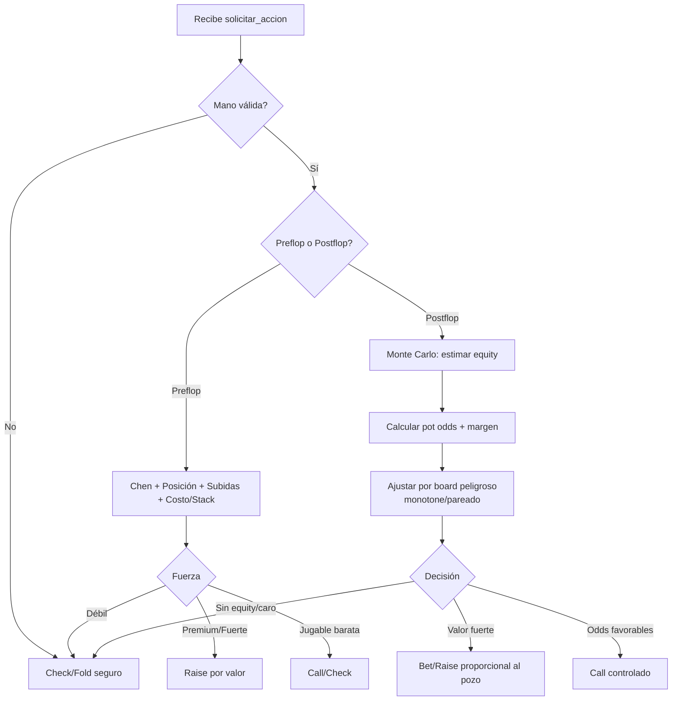

# ReadingSteinerBot — PokerFight AICS

> Bot de **Texas Hold'em No-Limit** para el torneo **PokerFight (AICS PUCP)**.  
> Corre en tu máquina, se conecta por **TCP + JSON Lines** y juega de forma 100% autónoma.

---

## 1) Lógica de creación

La idea detrás de **ReadingSteinerBot** es simple: en un torneo donde las fichas se conservan entre rondas y quedarte en cero te elimina, no conviene jugar "loco" ni "demasiado pasivo". Conviene jugar con **valor esperado (EV)**, controlar el riesgo y adaptarse a la textura del board.

El nombre es un guiño a *Steins;Gate*: el bot intenta "leer líneas posibles" (equity, pot odds, presión y peligro del board) antes de actuar.

### Principios de diseño
- **Robusto antes que bonito**: decisiones explicables y estables contra distintos estilos de bots.
- **Compatible con la arena oficial**: usa `pkg/botsdk` y `pkg/poker` del kit oficial.
- **Seguro bajo presión**: respeta `acciones_validas`, timeout de 5s y fallback seguro.

---

## 2) Mecánica de juego

### Resumen estratégico

| Fase | Qué hace | Objetivo |
|---|---|---|
| **Preflop** | Selección TAG con fórmula de **Chen** + posición + costo/stack + subidas previas | Entrar con manos rentables, evitar basura |
| **Postflop** | **Monte Carlo equity** vs **pot odds** + textura del board | Apostar por valor, pagar solo cuando conviene, evitar desastres |
| **Torneo** | Control de riesgo y sizing disciplinado | Sobrevivir, acumular fichas, no autoeliminarse |

### Flujo de decisión



### Preflop (TAG + posición)
- Puntúa la mano inicial con **Chen**.
- Ajusta por posición (botón tardío vs ciegas/temprano), número de rivales y subidas previas.
- **Premium**: raise por valor (3-4 BB + ajuste).
- **Marginal**: solo paga si es barato respecto al stack.
- **Basura**: fold/check.

### Postflop (Monte Carlo + Pot Odds)
- Simula cartas desconocidas (rivales + board restante) con presupuesto de tiempo controlado.
- Evalúa manos con `pkg/poker` (mismo evaluador que la arena).
- Compara `equity` vs `pot odds = costo / (pozo + costo)`.
- Aplica margen extra ante:
  - apuestas grandes o subidas,
  - boards peligrosos (monotone/pareado),
  - river con manos medias débiles.

### Gestión de riesgo (clave en torneo)
- Evita all-ins especulativos.
- No paga overbets con equity marginal.
- Prefiere líneas consistentes que acumulen fichas a jugadas de alta varianza innecesaria.

---

## 3) Cumplimiento con bases / guía

- **Protocolo**: TCP + JSON Lines, versión `1.0.0`.
- **Mensajes**: maneja `bienvenida`, `mano_inicio`, `solicitar_accion`, `estado`, `mano_fin`, `error`.
- **Acción válida**: responde solo con acciones en `acciones_validas`.
- **Monto correcto**: usa constructores del SDK; `monto` = **total de apuesta en la ronda**.
- **Tiempo**: respeta el límite de 5s (simulación con presupuesto interno acotado).
- **Fallback seguro**: ante caso inválido, check/fold seguro.
- **Sin intervención humana**: decisiones 100% automáticas.
- **Sin secretos en repo**: no se incluyen tokens, contraseñas ni API keys.

---

## 4) Estructura del repositorio

```text
.
├── README.md
├── .gitignore
├── go.mod
├── go.sum
└── bots/
    └── ReadingSteinerBot/
        └── main.go
```

---

## 5) Cómo compilar y ejecutar

### Requisitos
- Go instalado (recomendado Go 1.22+).

### Compilar
```bash
go build -o bin/ReadingSteinerBot ./bots/ReadingSteinerBot
```

### Ejecutar contra una mesa/servidor
```bash
./bin/ReadingSteinerBot -addr HOST:PUERTO -token TU_TOKEN -simulaciones 1000
```

Flags útiles:
- `-addr`: dirección `host:puerto`.
- `-token`: credencial del equipo (privada, no subir al repo).
- `-simulaciones`: simulaciones Monte Carlo por decisión (default 1200).
- `-semilla`: semilla RNG reproducible.
- `-detalle`: logs de decisión para debug.

---

## 6) Prueba local con el kit oficial

```bash
# 1) Clonar y compilar el kit oficial
git clone https://github.com/aicspucp/pokerfight-arena-participantes.git
cd pokerfight-arena-participantes
go build -o bin/ ./cmd/... ./bots/...

# 2) Levantar mesa local (formato cercano a clasificatoria)
./bin/mesa -addr :9000 -jugadores 5 -min-jugadores 5 -rondas 50 -stack 10000 -ciega-chica 50 -ciega-grande 100 -timeout-ms 5000

# 3) Conectar rivales y tu bot (en otra terminal)
./bin/ReadingSteinerBot -addr localhost:9000 -token mi-bot -simulaciones 1000
```

---
